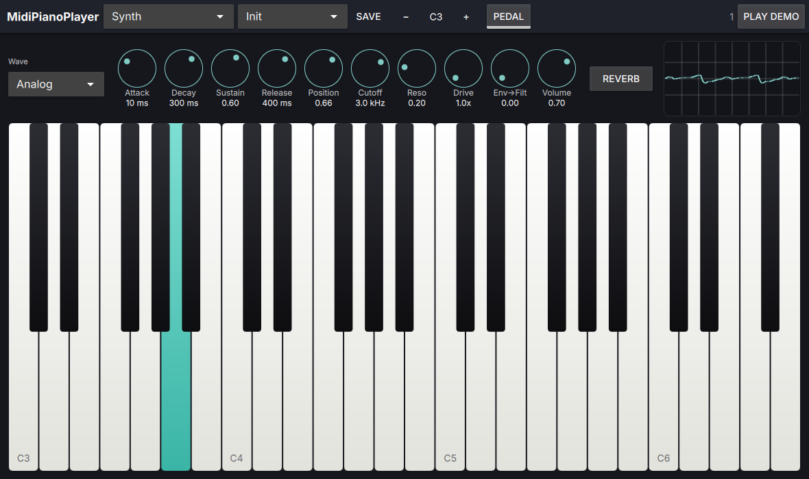
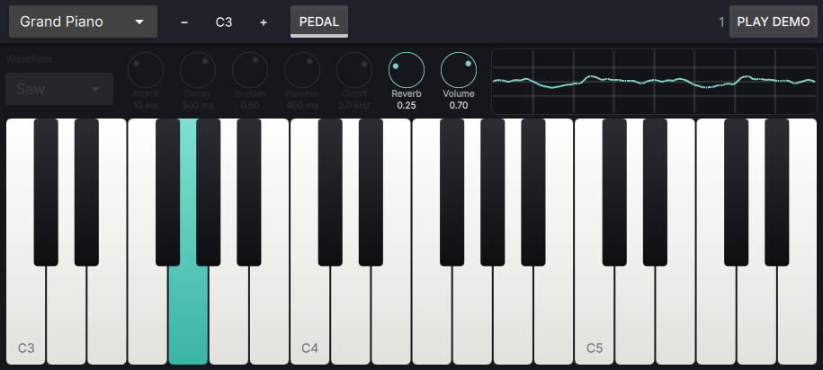
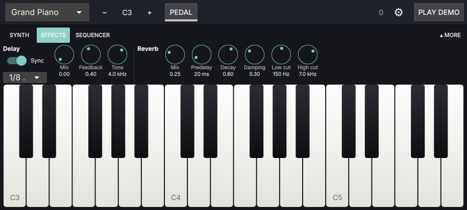
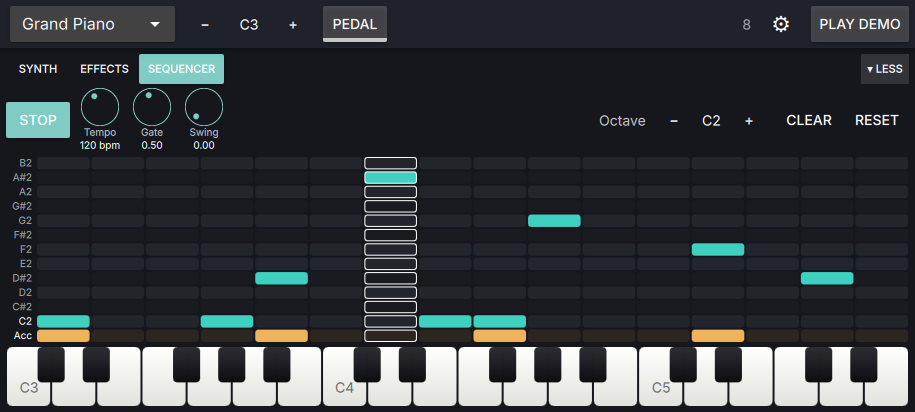
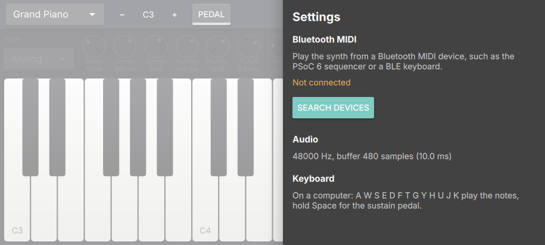

# MidiPianoPlayer

A polyphonic softsynth with a multitouch piano keyboard, written in C++17 with Qt Quick. The same code
runs as a desktop app (Windows, macOS, Linux) and as an Android app. A PSoC 6 MIDI sequencer (or any
Bluetooth MIDI device) plays it over Bluetooth LE MIDI; without hardware, the built-in demo sequencer
plays the same kind of pattern.



## Features

* A sampled **Grand Piano** and 7 more sampled instruments (Bright Grand, Tine and FM electric piano,
  Vibraphone, Pipe Organ, Strings, Warm Pad), played from a SoundFont with
  [TinySoundFont](https://github.com/schellingb/TinySoundFont).
* A built-in wavetable synth: 8 voices with voice stealing, four classic waveforms and six wavetables
  (Analog, Harmonics, PWM, Sync, Formant, Fold) that you morph through with the Position knob. The
  tables are band-limited per octave with an FFT, so high notes don't alias. Every voice has an ADSR
  envelope and a resonant 24 dB ladder filter with drive and filter envelope; at full resonance it
  self-oscillates.
* A multitouch keyboard: slide over the keys (glissando), and touch lower on a key to play louder.
  On a PC you can also play with the mouse or the computer keyboard (`A W S E D F T G Y H U J K`).
* A live oscilloscope drawn with OpenGL.
* Presets saved as text files, with five factory presets (Soft Pad, Square Lead, Pluck, Sine Organ, Nasty Acid).
* A demo sequencer running on its own thread. Its notes light up on the keyboard.
* Low-latency audio through [miniaudio](https://miniaud.io): WASAPI, Core Audio, PulseAudio/ALSA or AAudio.
* Bluetooth LE MIDI input: search and connect from the settings panel, then play from the PSoC 6 or any BLE MIDI device.
* Three panels, Synth, Effects and Sequencer, that you switch with tabs. **▴ More** makes the panel
  big (the keyboard gets smaller), like the hidden advanced section of an Arturia synth.
* A 16-step sequencer: tempo, gate, swing, accents, and a note grid in the big view. It plays on its
  own thread with drift-free timing.
* A delay (echo) with feedback, tone and tempo sync (1/16 to 1/2, dotted values too).
* A sustain pedal (button, space bar or MIDI CC 64) and a Freeverb-style reverb that works on every instrument.
* On Android the app always runs in landscape, with a compact control bar so the keyboard gets the most room.









<!-- Vereiste 20: 20.working build manual as readme on GitHub (project must be possible to build from scratch on a clean PC) -->
## Build manual

You need Qt 6.4 or newer (6.8 LTS recommended), CMake 3.16+ and a C++17 compiler. Everything else
(miniaudio) is included in `third_party/`.

### Windows (Qt Creator)

1. Download the [Qt Online Installer](https://www.qt.io/download-qt-installer) and log in with a free Qt account.
2. Choose **Custom installation** and tick:
   * **Qt → Qt 6.8.x → MinGW 13.1.0 64-bit** (and **Android** if you want the phone app, see below)
   * **Qt → Qt 6.8.x → Additional Libraries → Qt Connectivity** (for Bluetooth MIDI; without it the
     app still builds, only without Bluetooth)
   * **Developer and Designer Tools → Qt Creator, CMake, Ninja, MinGW 13.1.0 64-bit**
3. Clone this repository (or download the ZIP from GitHub):
   `git clone https://github.com/jmartens90/MidiPianoPlayer.git`
4. In Qt Creator: **File → Open File or Project…**, then pick the top-level `CMakeLists.txt`.
5. Select the **Desktop Qt 6.8.x MinGW 64-bit** kit and click **Configure Project**.
6. Click the green **Run** button (Ctrl+R). The app starts and you can play.
7. To run the unit tests, choose the `midipiano_tests` target in the bottom-left run selector and press Run.
   Or use **Tools → Tests → Run All Tests**.

### Linux (Ubuntu 24.04)

```
sudo apt install git cmake g++ qt6-base-dev qt6-declarative-dev qt6-connectivity-dev libgl-dev \
                 qml6-module-qtquick-controls qml6-module-qtquick-layouts \
                 qml6-module-qtquick-window qml6-module-qtqml-workerscript qml6-module-qtquick-templates
git clone https://github.com/jmartens90/MidiPianoPlayer.git
cd MidiPianoPlayer
cmake -B build
cmake --build build -j
ctest --test-dir build          # unit tests
./build/app/MidiPianoPlayer     # the app
```

### macOS

Install Xcode Command Line Tools (`xcode-select --install`) and Qt 6.8 for macOS with the Qt Online
Installer. Then open `CMakeLists.txt` in Qt Creator and run it, the same way as on Windows.

### Android

1. In the Qt installer, also tick **Qt 6.8.x → Android** (the arm64-v8a ABI covers almost every phone).
2. In Qt Creator: **Edit → Preferences → Devices → Android**. Click **Set Up SDK** and let it
   download the JDK, Android SDK and NDK it asks for.
3. On the phone: **Settings → About phone →** tap **Build number** 7 times, then in
   **Developer options** turn on **USB debugging**. Connect the phone with USB and allow the PC.
4. In Qt Creator, add the **Android Qt 6.8.x Clang arm64-v8a** kit to the project (Projects tab).
5. Select that kit and click **Run**. Qt Creator builds the APK, installs it and starts it on the phone.

Only the app is built for Android. The unit tests run on the PC.

## Bluetooth MIDI

The app can be played from any Bluetooth LE MIDI device: the PSoC 6 sequencer of this project, a BLE
MIDI keyboard, or a phone/PC app that sends BLE MIDI.

1. Open **⚙ Settings** and tap **Search devices**. On Android the first time asks for Bluetooth
   permission.
2. Devices that advertise MIDI are at the top, marked **• MIDI**. Tap one to connect.
3. Play on the device. Its notes play on the current instrument and light up on the keyboard;
   CC 64 works as the sustain pedal.

What the PSoC 6 (or any device) has to do: act as a BLE peripheral with the standard BLE MIDI
service `03B80E5A-EDE8-4B33-A751-6CE34EC4C700` and the characteristic
`7772E5DB-3868-4112-A1A9-F2669D106BF3` (read, write without response, notify), and send each MIDI
message as a notification in the BLE MIDI packet format: `[header] [timestamp] [status] [data...]`.
`BleMidiParser` (tested in `tests/BleMidiTests.cpp`, no hardware needed) handles running status,
several messages per packet, realtime bytes and SysEx.

### Timing and latency

From a key press on the PSoC 6 to sound is roughly 20 to 35 ms. To keep the rhythm tight:

* The app asks for a short Bluetooth connection interval (7.5 to 15 ms) once it is connected.
* Every BLE MIDI message carries a 13-bit millisecond timestamp. `BleClockSync` maps it to the
  phone's clock, so notes the PSoC sent 10 ms apart play exactly 10 ms apart, even when the radio
  delivers them unevenly ("Steady Bluetooth timing" in Settings; off = play on arrival).
* The synth plans notes on an exact sample inside the audio block (`Synth::schedule`), and the step
  sequencer sends its notes one audio block ahead, so its timing no longer depends on the buffer size.
* **Settings → Buffer** chooses the audio buffer: Auto, 5, 10 or 20 ms. Smaller responds faster but
  needs a faster phone.

## Using the app

| Control | What it does |
|---|---|
| Keys | Touch, click or type to play. Several fingers = a chord. Slide = glissando. Low on a key = louder |
| Instrument | Grand Piano and the other sampled instruments, or "Synth" for the built-in synth |
| Wave | (Synth only) Sine, Saw, Square, Triangle, or one of the six wavetables |
| Position | (Synth, wavetables only) Morphs through the frames of the wavetable |
| Attack / Decay / Sustain / Release | (Synth only) How a note fades in, drops to its held level, and rings out |
| Cutoff | (Synth only) Low-pass filter: lower = darker sound |
| Reso | (Synth only) Filter resonance: a whistling peak at the cutoff; at the top the filter sings by itself |
| Drive | (Synth only) Pushes the filter into saturation for a dirtier sound |
| Env→Filt | (Synth only) How far the envelope opens the filter on every note (the "acid" squelch) |
| Synth / Effects / Sequencer | Tabs above the knobs. **▴ More** / **▾ Less** makes the panel big or small |
| Delay (Effects) | Mix, Feedback, Tone, and Time, or with **Sync** on a note value that follows the sequencer tempo |
| Reverb (Effects) | Mix, Predelay, Decay, Damping, Low cut (pre-filter on the reverb input) and High cut (post-filter on the reverb output) |
| Sequencer | Play/Stop, Tempo, Gate, Swing. Tap a step to switch it on or off. In the big view, tap a cell to put that note on that step, and use the bottom row for accents; Octave −/+ moves the grid, Clear and Reset change the whole pattern |
| Volume | Master volume |
| Pedal | Sustain pedal: released notes keep ringing until you turn it off. On a PC you can also hold the space bar |
| Octave − / + | Shift the keyboard from C0 to C6 |
| ⚙ (Settings) | Bluetooth MIDI (search, connect, disconnect), audio buffer size, steady Bluetooth timing, audio info and keyboard help. A blue dot means a Bluetooth device is connected |
| Preset list / Save | (Synth only) Load a preset, or save the current synth sound under a name |
| Play demo | Starts the demo sequencer (an Am - F - C - G arpeggio) |

Presets are plain text files in the app's data folder, for example
`%APPDATA%/MidiPianoPlayer/MidiPianoPlayer/presets` on Windows or
`~/.local/share/MidiPianoPlayer/MidiPianoPlayer/presets` on Linux.

## Project structure

| Folder | Contents |
|---|---|
| `core/` | The sound engine without Qt: `dsp` (instruments, SoundFont, oscillators, wavetables, envelope, ladder filter, reverb, voice, synth), `midi` (messages, sources, demo sequencer), `preset` (patches, files), `audio` (sound card), `util` |
| `app/` | The Qt Quick app: `Application`, `SynthController`, `WaveformView` (OpenGL) the QML files, and `android/AndroidManifest.xml` (locks the phone app to landscape) |
| `tests/` | Unit tests for `core/` |
| `docs/` | [Test plan](docs/TESTPLAN.md) and screenshots |
| `tools/` | `check_vereisten.py`, which checks that every requirement is marked in the code |
| `assets/soundfonts/` | `instruments.sf2`: 8 presets cut from [GeneralUser GS](https://www.schristiancollins.com/generaluser) v2.0.3 by S. Christian Collins ([license](assets/soundfonts/GeneralUser-GS-LICENSE.txt)) |
| `third_party/miniaudio/` | [miniaudio](https://github.com/mackron/miniaudio) 0.11.26 (public domain / MIT-0) |
| `third_party/tinysoundfont/` | [TinySoundFont](https://github.com/schellingb/TinySoundFont) (MIT) |

<!-- Vereiste 1: 1.UML diagram of the entire planned project -->
## UML class diagram

The whole project. `BleMidiSource` receives notes from the PSoC 6 sequencer (external hardware, not
part of the C++ code) over Bluetooth LE and plugs into the same `MidiSource` interface as the demo
sequencer. A PNG version is in
[docs/images/uml.png](docs/images/uml.png).

```mermaid
classDiagram
    direction LR

    class Application {
        -QGuiApplication app_
        -QQmlApplicationEngine engine_
        +run() int
    }
    class SynthController {
        <<QObject>>
        -Synth synth_
        -unique_ptr~AudioOutput~ audio_
        -unique_ptr~MidiSource~ source_
        -unique_ptr~PresetStore~ store_
        +noteOn(note, velocity = 100)
        +noteOff(note)
        +setParam(name, value)
        +toggleSequencer()
        +savePreset(name)
        +loadPreset(name)
        signal noteStateChanged(note, on)
        signal scopeUpdated()
    }
    class WaveformView {
        <<QQuickFramebufferObject>>
        +synth : SynthController*
        +createRenderer() Renderer*
    }
    class ScopeRenderer {
        <<OpenGL>>
        +synchronize(item)
        +render()
    }
    class Instrument {
        <<abstract>>
        +noteOn(note, velocity)*
        +noteOff(note)*
        +render(out, frames)*
        +activeVoiceCount()* size_t
        +usesPatch() bool
    }
    class VoiceSynth {
        -array~Voice, 8~ voices_
        +noteOn(note, velocity)
        -findFreeVoice() Voice*
    }
    class SoundFont {
        -tsf* font_
        +fromFile(path)$ shared_ptr~SoundFont~
        +fromMemory(bytes)$ shared_ptr~SoundFont~
        +presetName(i) string
    }
    class SoundFontInstrument {
        -shared_ptr~SoundFont~ font_
        -tsf* voices_
        +~SoundFontInstrument()
    }
    class Synth {
        -vector~unique_ptr~Instrument~~ instruments_
        -Patch patch_
        -mutex mutex_
        -RingBuffer~float~ scope_
        -Reverb reverb_
        -bitset~128~ sustained_
        +handle(const MidiMessage&)
        +noteOn(note, velocity = 100)
        +noteOff(note)
        +setSustain(bool)
        +render(vector~float~&)
        +addInstrument(unique_ptr~Instrument~)
        +selectInstrument(index)
        +applyPatch(const Patch&)
    }
    class Delay {
        -vector~float~ line_
        -float currentDelay_
        +setSettings(const Settings&)
        +process(float*, frames)
    }
    class StepSequencer {
        -array~Step,16~ pattern_
        -thread thread_
        -atomic~float~ bpm_
        +setStep(index, Step)
        +currentStep() int
    }
    class Reverb {
        -Settings settings_
        -vector~float~ predelayLine_
        -vector~Comb~ combs_
        -vector~Allpass~ allpasses_
        +setSettings(const Settings&)
        +process(float*, frames)
    }
    class Voice {
        -unique_ptr~Oscillator~ oscillator_
        -LowPassFilter filter_
        -Envelope envelope_
        -uint8_t note_
        +start(note, velocity, time)
        +release()
        +render(sampleRate) float
    }
    class Oscillator {
        <<base class>>
        -float phase_
        +next(freq, sampleRate) float
        +sample(phase)* float
        +name()* string
        +prepare(freq, sampleRate)
        +setPosition(position)
    }
    class WavetableOscillator {
        -shared_ptr~const Wavetable~ table_
        -float position_
    }
    class Wavetable {
        -vector~float~ data_
        +Wavetable(name, shape)
        +read(phase, position, mipLevel) float
        +mipLevelFor(freq, sampleRate)$ size_t
    }
    class SineOscillator
    class SawOscillator
    class SquareOscillator
    class TriangleOscillator
    class OscillatorFactory {
        +create(Waveform)$ unique_ptr~Oscillator~
    }
    class Envelope {
        -Stage stage_
        +Envelope()
        +Envelope(a, d, s, r)
        +noteOn()
        +noteOff()
        +next(sampleRate) float
    }
    class LowPassFilter {
        -array~float,4~ stage_
        +setCutoff(hz)
        +setResonance(amount)
        +setDrive(drive)
        +process(x, sampleRate, cutoff) float
    }
    class MidiMessage {
        -uint8_t status_
        -uint8_t data1_
        -uint8_t data2_
        +MidiMessage()
        +MidiMessage(status, d1, d2)
        +MidiMessage(const MidiMessage&)
        +isNoteOn() bool
        +friend operator out(ostream)
    }
    class MidiSource {
        <<abstract>>
        +start(Callback)*
        +stop()*
        +isRunning()* bool
        +name()* string
    }
    class DemoSequencer {
        -thread thread_
        -vector~Step~ pattern_
        +~DemoSequencer()
    }
    class BleMidiSource {
        <<QObject>>
        -QLowEnergyController* controller_
        -BleMidiParser parser_
        +startScan()
        +connectTo(index)
        +handlePacket(QByteArray)
    }
    class BleMidiParser {
        -uint8_t runningStatus_
        +parse(bytes, length) vector~MidiMessage~
    }
    class PSoC6Sequencer {
        <<external hardware>>
        BLE MIDI peripheral
    }
    class Patch {
        -string name_
        -Waveform waveform_
        -map~string, Param~ params_
        +Patch()
        +Patch(const Patch&)
        +set(name, value) Patch&
        +friend operator out(ostream)
    }
    class Param {
        -float value_
        +value() float
        +setValue(v)
    }
    class PresetStore {
        +save(const Patch&)
        +load(const string&) Patch
        +list() vector~string~
    }
    class AudioOutput {
        -unique_ptr~ma_device~ device_
        +~AudioOutput()
        -dataCallback()$
    }
    class RingBuffer~T~ {
        -T* data_
        +push(const T&)
        +copyTo(vector~T~&)
    }

    Application ..> SynthController : QML creates
    SynthController *-- Synth
    SynthController *-- AudioOutput
    SynthController *-- MidiSource
    SynthController *-- PresetStore
    WaveformView ..> SynthController : scopeUpdated()
    WaveformView ..> ScopeRenderer : creates
    AudioOutput ..> Synth : render() on audio thread
    Synth *-- "1..*" Instrument
    Instrument <|-- VoiceSynth
    Instrument <|-- SoundFontInstrument
    VoiceSynth *-- "8" Voice
    SoundFontInstrument o-- SoundFont : shared
    Synth *-- Patch
    Synth *-- RingBuffer
    Synth *-- Reverb
    Synth *-- Delay
    MidiSource <|-- StepSequencer
    SynthController *-- StepSequencer
    Synth ..> MidiMessage : handle()
    SynthController ..> SoundFont : loads instruments.sf2
    Voice *-- Oscillator
    Voice *-- Envelope
    Voice *-- LowPassFilter
    Oscillator <|-- SineOscillator
    Oscillator <|-- SawOscillator
    Oscillator <|-- SquareOscillator
    Oscillator <|-- TriangleOscillator
    Oscillator <|-- WavetableOscillator
    WavetableOscillator o-- Wavetable
    OscillatorFactory ..> Oscillator : creates
    MidiSource <|-- DemoSequencer
    MidiSource <|-- BleMidiSource
    BleMidiSource *-- BleMidiParser
    BleMidiParser ..> MidiMessage : creates
    SynthController *-- BleMidiSource
    BleMidiSource ..> PSoC6Sequencer : Bluetooth LE MIDI
    MidiSource ..> MidiMessage : sends
    Patch *-- Param
    PresetStore ..> Patch : reads/writes
```



## Requirements (Vereisten)

Every requirement is marked in the code with a comment that starts with `Vereiste <n>:`, followed by a
concrete explanation. Search for it with Ctrl+F, or run `python3 tools/check_vereisten.py` for a list.

| # | Requirement | Where |
|---|---|---|
| 1 | UML diagram of the entire planned project | this README, [UML](#uml-class-diagram) |
| 2 | useful and correct abstraction (explain why) | [`core/include/midipiano/dsp/Synth.h`](core/include/midipiano/dsp/Synth.h) |
| 3 | useful and correct encapsulation (explain why) | [`core/include/midipiano/preset/Param.h`](core/include/midipiano/preset/Param.h) |
| 4 | useful and correct inheritance (explain why) | [`core/include/midipiano/dsp/Waveforms.h`](core/include/midipiano/dsp/Waveforms.h) |
| 5 | useful and correct polymorphism (explain why) | [`core/src/Synth.cpp`](core/src/Synth.cpp) |
| 6 | useful and correct object composition (explain why) | [`core/include/midipiano/dsp/Voice.h`](core/include/midipiano/dsp/Voice.h) |
| 7 | useful and correct base class | [`core/include/midipiano/dsp/Oscillator.h`](core/include/midipiano/dsp/Oscillator.h) |
| 8 | useful and correct abstract base class | [`core/include/midipiano/midi/MidiSource.h`](core/include/midipiano/midi/MidiSource.h) |
| 9 | useful and correct virtual function | [`core/include/midipiano/dsp/Oscillator.h`](core/include/midipiano/dsp/Oscillator.h) |
| 10 | no mistake in object-oriented programming | _whole project_ |
| 11 | clean main (i.e. nothing in the main that should be in a class) | [`app/main.cpp`](app/main.cpp) |
| 12 | no globals, but statics if needed | _whole project_ |
| 13 | correct protections (for header files) | [`core/include/midipiano/dsp/Oscillator.h`](core/include/midipiano/dsp/Oscillator.h) |
| 14 | maintainability by clean uniform code style and good function naming and/or comments everywhere | _whole project_ |
| 15 | separate header files | _whole project_ |
| 16 | one complete project that compiles and does not crash | _whole project_ |
| 17 | fully working project | _whole project_ |
| 18 | sufficient git commits (+/- weekly) | _whole project_ |
| 19 | correct files on git | _whole project_ |
| 20 | working build manual as readme on GitHub (project must be possible to build from scratch on a clean PC) | this README, [Build manual](#build-manual) |
| 21 | at least 2 default constructors | [`core/include/midipiano/dsp/Envelope.h`](core/include/midipiano/dsp/Envelope.h), [`core/include/midipiano/midi/MidiMessage.h`](core/include/midipiano/midi/MidiMessage.h), [`core/include/midipiano/preset/Patch.h`](core/include/midipiano/preset/Patch.h) |
| 22 | at least 2 parameterized constructors | [`core/include/midipiano/dsp/Envelope.h`](core/include/midipiano/dsp/Envelope.h), [`core/include/midipiano/midi/MidiMessage.h`](core/include/midipiano/midi/MidiMessage.h) |
| 23 | at least 2 copy constructors | [`core/include/midipiano/midi/MidiMessage.h`](core/include/midipiano/midi/MidiMessage.h), [`core/include/midipiano/preset/Patch.h`](core/include/midipiano/preset/Patch.h) |
| 24 | at least 2 destructors | [`core/include/midipiano/audio/AudioOutput.h`](core/include/midipiano/audio/AudioOutput.h), [`core/include/midipiano/midi/DemoSequencer.h`](core/include/midipiano/midi/DemoSequencer.h) |
| 25 | member initialization in constructors (the stuff behind a colon) | [`core/include/midipiano/midi/MidiMessage.h`](core/include/midipiano/midi/MidiMessage.h), [`core/src/Voice.cpp`](core/src/Voice.cpp) |
| 26 | constructor forwarding | [`core/include/midipiano/dsp/Envelope.h`](core/include/midipiano/dsp/Envelope.h) |
| 27 | useful proven (dynamic) polymorphism | [`tests/DspTests.cpp`](tests/DspTests.cpp) |
| 28 | useful usage of "this" (if the code does not work without it) | [`core/src/AudioOutput.cpp`](core/src/AudioOutput.cpp), [`core/src/Patch.cpp`](core/src/Patch.cpp) |
| 29 | useful member function | [`core/src/VoiceSynth.cpp`](core/src/VoiceSynth.cpp) |
| 30 | default values in function definition | [`core/include/midipiano/dsp/Synth.h`](core/include/midipiano/dsp/Synth.h) |
| 31 | useful member variabel | [`core/include/midipiano/dsp/Voice.h`](core/include/midipiano/dsp/Voice.h) |
| 32 | useful getters and setters for member variables | [`core/include/midipiano/preset/Param.h`](core/include/midipiano/preset/Param.h) |
| 33 | correct usage of inline function | [`core/include/midipiano/util/MathUtil.h`](core/include/midipiano/util/MathUtil.h) |
| 34 | useful template function or class | [`core/include/midipiano/util/RingBuffer.h`](core/include/midipiano/util/RingBuffer.h) |
| 35 | useful friend function or class | [`core/include/midipiano/preset/Patch.h`](core/include/midipiano/preset/Patch.h) |
| 36 | everything in one or more self-made useful namespace(s) | [`core/include/midipiano/util/MathUtil.h`](core/include/midipiano/util/MathUtil.h) |
| 37 | 2 useful unsigned chars or other better usage of memory efficient type | [`core/include/midipiano/dsp/Waveforms.h`](core/include/midipiano/dsp/Waveforms.h), [`core/include/midipiano/midi/MidiMessage.h`](core/include/midipiano/midi/MidiMessage.h) |
| 38 | at least 4 useful const references for variables | [`app/SynthController.cpp`](app/SynthController.cpp), [`core/src/DemoSequencer.cpp`](core/src/DemoSequencer.cpp), [`core/src/PresetStore.cpp`](core/src/PresetStore.cpp), [`core/src/Synth.cpp`](core/src/Synth.cpp) |
| 39 | at least 4 useful const references for functions | [`core/src/PresetStore.cpp`](core/src/PresetStore.cpp) |
| 40 | 2 useful and correct smart pointers | [`app/SynthController.h`](app/SynthController.h), [`core/include/midipiano/dsp/SoundFont.h`](core/include/midipiano/dsp/SoundFont.h), [`core/include/midipiano/dsp/Voice.h`](core/include/midipiano/dsp/Voice.h) |
| 41 | dynamic memory allocation (new) | [`core/include/midipiano/util/RingBuffer.h`](core/include/midipiano/util/RingBuffer.h) |
| 42 | dynamic memory removing (delete or kill children) | [`core/include/midipiano/util/RingBuffer.h`](core/include/midipiano/util/RingBuffer.h) |
| 43 | 2 useful (modern) call-by-references | [`core/src/Synth.cpp`](core/src/Synth.cpp) |
| 44 | useful string class usage (c++ functionality) | [`core/src/PresetStore.cpp`](core/src/PresetStore.cpp) |
| 45 | useful container class | [`core/include/midipiano/dsp/VoiceSynth.h`](core/include/midipiano/dsp/VoiceSynth.h) |
| 46 | useful usage of nullptr | [`core/src/VoiceSynth.cpp`](core/src/VoiceSynth.cpp) |
| 47 | useful usage of (modern) file-I/O | [`core/src/PresetStore.cpp`](core/src/PresetStore.cpp) |
| 48 | useful exception handling | [`core/src/PresetStore.cpp`](core/src/PresetStore.cpp) |
| 49 | useful usage of a lambda function | [`app/SynthController.cpp`](app/SynthController.cpp) |
| 50 | useful usage of threads | [`core/src/DemoSequencer.cpp`](core/src/DemoSequencer.cpp) |
| 51 | useful Qt class (self made) | [`app/SynthController.h`](app/SynthController.h) |
| 52 | useful usage of signals/slots | [`app/SynthController.cpp`](app/SynthController.cpp) |
| 53 | test-driven development (= written test plan or unit tests) | [`docs/TESTPLAN.md`](docs/TESTPLAN.md), [`tests/DspTests.cpp`](tests/DspTests.cpp) |
| 54 | solve bug ticket (with pull request or commit message issue link and issue branch) | _planned_ |
| 55 | report a bug ticket on another project | _planned_ |
| 56 | meaningful usage of a GUI (not just a screen that shows some text and a textfield) | [`app/qml/Main.qml`](app/qml/Main.qml) |
| 57 | usage of OpenGL or other 3D engine | [`app/WaveformView.cpp`](app/WaveformView.cpp) |
| 58 | useful (non trivial) usage of an external library (not Qt) | [`core/src/AudioOutput.cpp`](core/src/AudioOutput.cpp) |
| 59 | project that communicates (e.g. UART, BT) with hardware | [`app/BleMidiSource.cpp`](app/BleMidiSource.cpp) |
| 60 | a nice extra that you think that should deserve grading (stuff you put time in and is not rewarded by an item above) | [`app/CMakeLists.txt`](app/CMakeLists.txt) |

## Roadmap

1. Bug ticket on an issue branch, fixed by a pull request (requirement 54).
2. Report a bug on another project (requirement 55).
